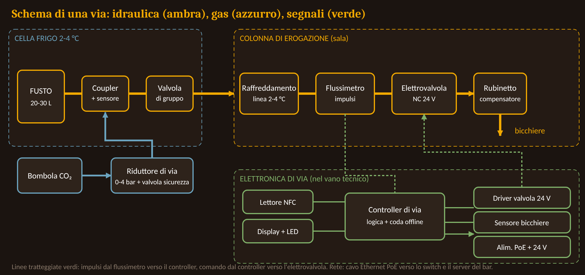

# 1. L'idea in breve

SelfTap (nome di lavoro) è una birreria **senza bancone e senza barista**. I clienti si servono da soli alle spillatrici elettroniche. Ogni spillatrice misura quanta birra viene erogata e la traduce in un prezzo espresso in **euro al litro**. Non c'è limite al numero di spillate: il conto si paga **una sola volta, in cassa, a fine serata**, in base a quanto si è realmente bevuto.

L'obiettivo è dare al cliente la sensazione di un **open bar**, cioè libertà di servirsi quando vuole senza chiedere e senza pagare ogni giro, ma senza il limite economico di un prezzo fisso per tutti.

Il progetto è oggi **teorico**: non esiste un locale, un budget o una data di apertura. Questo documento serve a chiarire il concept, a decidere le scelte principali e a preparare i materiali da presentare a possibili investitori.

# 2. Perché potrebbe funzionare

- **Meno attese:** non c'è il banco come collo di bottiglia.
- **Meno costi di personale** al bancone: restano cassa e sorveglianza di sala.
- **Esperienza memorabile:** spillarsi la birra da soli è un'attrazione, soprattutto per i gruppi.
- **Dati:** ogni spillata viene registrata, quindi si sa cosa e quanto si consuma, e si può gestire il magazzino in modo preciso.
- **Pagamento onesto:** si paga il consumo reale, a differenza di un open bar a prezzo fisso.

# 3. Come funziona per il cliente

1. **Ingresso.** In cassa si controlla il documento (solo maggiorenni) e si consegna un **braccialetto NFC**. Il braccialetto è associato a un conto aperto e contiene solo un codice, nessun dato personale. Come garanzia si prevede una preautorizzazione sulla carta da 40 € (o una cauzione in contanti da 20 €).
2. **Spillata.** Il cliente avvicina il braccialetto al lettore della spillatrice: lo schermo mostra la birra e "Pronto". Appoggia il bicchiere, preme la leva e spilla. Lo schermo mostra i **litri** erogati; l'importo si vede solo se lo si chiede, per non rovinare la sensazione di libertà.
3. **Chiusura.** Riavvicina il braccialetto: la valvola si chiude e la quantità viene aggiunta al conto.
4. **Uscita.** In cassa il braccialetto viene letto, il cassiere mostra il dettaglio per birra e il totale, e il cliente paga con carta o contanti. Il braccialetto viene disattivato.

I prototipi cliccabili di schermo e gestionale sono in `ui/spillatrice.html` e `ui/gestionale.html`.

# 4. Come funziona per il bar

Il personale usa un **gestionale** con queste schermate:

- **Sala live:** conti aperti, litri erogati, ritmo di consumo di ogni cliente e allerte (ritmo troppo alto, fusto quasi vuoto, via fuori servizio).
- **Cassa:** lettura del braccialetto, dettaglio del conto, pagamento.
- **Nuovo cliente:** controllo dell'età, assegnazione del braccialetto, garanzia.
- **Spillatrici e fusti:** stato di ogni via e litri residui.
- **Listino:** prezzo al litro per ogni birra.

# 5. Responsabilità e regole

La somministrazione di alcol a minorenni e a persone già ubriache è vietata. Senza barista questo diventa il punto più delicato del progetto, quindi il sistema è pensato con diverse protezioni:

- Braccialetto attivo **solo dopo** il controllo del documento.
- **Addetti di sala** presenti, con la possibilità di **bloccare un braccialetto** da remoto in qualsiasi momento.
- **Avviso al personale** quando un cliente beve troppo velocemente (soglia da definire).
- Conferma delle condizioni del cliente al momento di pagare.
- Registrazione di tutte le spillate.

Altri punti da verificare con un consulente prima di ogni apertura: licenze di somministrazione, **omologazione dei misuratori** (se il prezzo dipende dai litri misurati), igiene (HACCP) e privacy. L'elenco completo è in `05-normativa-e-rischi.md`. Questo documento non è una consulenza legale.

# 6. Layout della sala

Due opzioni, con lo stesso software:

| | Isola di spillatrici | Spillatrice sul tavolo |
|---|---|---|
| Birre disponibili | Molte (8-16) | Poche per tavolo |
| Costo di impianto | Contenuto | Alto |
| Sorveglianza e pulizia | Semplici | Più complesse |
| Effetto "wow" | Buono | Massimo |

**Decisione proposta:** si parte con l'**isola**; la spillatrice sul tavolo diventa una seconda fase, per tavoli premium.

# 7. La spillatrice

Ogni "via" è composta da tre blocchi.

**Circuito della birra.** Il fusto (20-30 L) sta in una **cella frigo** sul retro, spinto da CO₂. La birra passa per una linea alimentare raffreddata (3-6 °C), poi per un **flussimetro**, che misura i millilitri, e per una **elettrovalvola** normalmente chiusa, che si apre solo se il cliente è autorizzato. Il **rubinetto** compensatore limita la schiuma.

**Elettronica.** Un piccolo controller per ogni via conta gli impulsi del flussimetro, comanda la valvola, legge il braccialetto NFC, pilota lo schermo e i LED di stato. Se la rete cade, la via continua a funzionare e sincronizza i dati dopo.

**Struttura.** Una colonna in acciaio inox alta circa 1,55 m, larga circa 30 cm per via, con vaschetta di scarico e sensore del bicchiere.

**Sicurezza:** la valvola è chiusa per default; c'è un limite di litri e di tempo per singola spillata; se il flussimetro misura birra a valvola chiusa, scatta un allarme e una valvola di gruppo chiude la via. Nella cella frigo serve un rilevatore di CO₂.

I dettagli e le quote sono in `06-progetto-spillatrice.md`; i costi stimati nella `distinta-materiali.xlsx`: indicativamente da 500 a 1.700 € di hardware per via e da 12.500 a 38.000 € per un'isola da 8 vie (stime non verificate).

# 8. Il software

Il sistema ha quattro parti: il **firmware** di ogni via, un **server** nel bar con database (che continua a funzionare anche senza Internet), il **gestionale** web e l'integrazione con la **cassa e il POS**. Ogni spillata genera un evento con codice univoco (braccialetto, via, millilitri, orario), così non può essere contata due volte. Il prezzo al litro viene copiato nella spillata, quindi un cambio di listino non modifica i conti già aperti. Dettagli in `04-software-architettura.md`.

# 9. Aspetti economici

Non esiste ancora un business plan. L'idea è che il margine nasca dal prezzo al litro meno il costo della birra, con un costo del personale più basso di un bar tradizionale, da compensare con l'impianto e la sorveglianza di sala. Le cifre nel pitch deck (13 € al litro di prezzo, 4 € di costo, 9 € di margine) sono **solo illustrative**.

# 10. Rischi principali

| Rischio | Risposta |
|---|---|
| Cliente ubriaco continua a bere | Sorveglianza, allerte, blocco remoto, formazione |
| Minori | Controllo documento, un braccialetto per persona, sorveglianza |
| Mancato pagamento | Preautorizzazione o cauzione |
| Misuratore non conforme o impreciso | Individuare presto un modello idoneo, test e taratura |
| Costo dell'impianto alto | Partire con un'isola, fare un pilota |

# 11. Piano di lavoro

1. **Concept** (questa fase): documenti, interfacce, specifiche.
2. **Prototipo** di una sola spillatrice su banco di prova.
3. **Pilota** in un evento o in un locale temporaneo.
4. **Apertura** del primo locale con isola di spillatrici.

# 12. Decisioni ancora aperte

- Nome e identità visiva.
- Parere di un consulente su licenze, misuratori omologati e responsabilità.
- Numero di vie e tipo di raffreddamento.
- Fusti classici o monouso a sacca.
- Formato dei bicchieri e gestione della schiuma.
- Soglia di consumo che fa scattare l'avviso.
- Ricerca di mercato e business plan.
